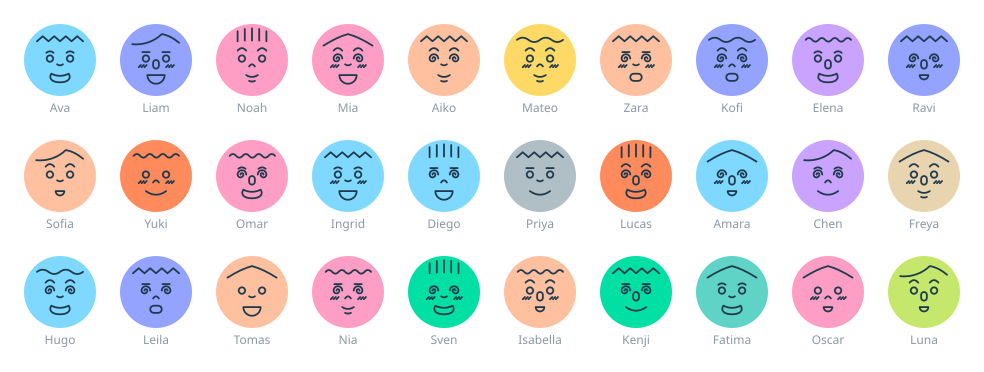

# profiler

Seeded placeholder profile avatars, drawn as plain SVG entirely in the browser. No API calls and no runtime dependencies. Written in TypeScript, with ready-made components for React, Vue and Angular.

| Import | Minified | Gzipped |
|---|---|---|
| `profiler` (core) | 2.9 KB | 1.5 KB |
| `profiler/react` | 0.3 KB | 0.3 KB |
| `profiler/vue` | 0.4 KB | 0.3 KB |
| `profiler/angular` | 2.6 KB | 0.9 KB |

The component sizes are on top of the core. They are not minified for Angular, because the Angular compiler in your app processes that file.



**[Live demo →](https://falseavarn.github.io/profiler/)**

```js
import { avatar } from 'profiler';

avatar('alice@example.com'); // → '<svg ...>...</svg>', the same face every time for this seed
```

## Combinations

Each seed picks one option for each of seven features:

| Feature | Options |
|---|---|
| Background color | 12 |
| Hair | 6 |
| Brows | 4 (including none) |
| Eyes | 2 (round, swirl) |
| Nose | 3 |
| Mouth | 6 |
| Cheeks | 2 (none, blush) |

12 × 6 × 4 × 2 × 3 × 6 × 2 = **20,736 unique faces**, each available in two shapes (circle and square).

Any string or number works as a seed: a user id, an email or a username. The seed is only hashed and never appears in the output, so passing untrusted input is safe.

## Install

From [JSR](https://jsr.io/@falseavarn/profiler) (core, React and Vue):

```sh
npx jsr add @falseavarn/profiler     # npm / Node projects
deno add jsr:@falseavarn/profiler    # Deno
```

Then import from `@falseavarn/profiler`, `@falseavarn/profiler/react` or `@falseavarn/profiler/vue`. The examples below use the short name `profiler`.

The Angular component isn't on JSR, because JSR ships TypeScript source and Angular apps need it pre-compiled. Install from GitHub instead, which runs the compiled build. The same works for local copies:

```sh
npm install ../profiler          # local path
npm install git+https://…/profiler.git
```

Installing from git or a local path runs the build automatically (the `prepare` script). Types ship with the package, so there's no separate `@types` install.

## API

```js
avatar(seed, shape = 'circle', { blink = false, spin = false } = {}) // → SVG string
follow(root = document)                                               // → stop()
```

| Argument | Description |
|---|---|
| `seed` | String or number. The same seed always gives the same face. |
| `shape` | `'circle'` (default) or `'square'`. A square fills its container at any aspect ratio and keeps the face centered. For rounded corners, use `'square'` with CSS `border-radius`. |
| `blink` | CSS blink animation. Avatars blink out of sync with each other. |
| `spin` | Spins swirl eyes; has no effect on round eyes. |
| `follow(root)` | Makes the eyes of every inline avatar inside `root` follow the pointer. It returns a function that stops tracking and recenters the eyes. |

The effects are off by default because they cost CPU. `blink` and `spin` turn themselves off when the user's system asks for reduced motion. `follow` only works on inline SVG, not on ``.

The SVG has a `viewBox` but no width or height, so you size it with CSS, e.g. `.avatar svg { width: 48px; height: 48px; }`.

## Framework usage

`avatar()` returns a string, so you can use it in two ways in any framework:

- **Inline SVG**: inject it as HTML. You can style it with CSS, and `follow()` works.
- **``**: use it as a data URI. It's isolated from page styles, and `follow()` won't reach it, but `blink` and `spin` still run.

```js
const src = 'data:image/svg+xml,' + encodeURIComponent(avatar(seed));
```

`follow()` uses browser APIs. Call it after the component mounts and call the stop function on unmount. `avatar()` itself is a pure function and works during SSR.

### Vanilla JS

```html
<div class="avatar"></div>
<script type="module">
  import { avatar, follow } from 'profiler';
  document.querySelector('.avatar').innerHTML = avatar('alice');
  const stop = follow(); // optional
</script>
```

### React

```tsx
import { Avatar } from 'profiler/react';

<Avatar seed="alice" className="avatar" />
<Avatar seed={user.id} shape="square" blink follow style={{ width: 48, height: 48 }} />
```

The component renders a `div` that wraps the SVG and passes any other `div` props through. Eye follow starts after mount and stops on unmount.

### Vue

```vue
<script setup lang="ts">
import { Avatar } from 'profiler/vue';
</script>

<template>
  <Avatar seed="alice" class="avatar" />
  <Avatar :seed="user.id" shape="square" blink follow />
</template>
```

### Angular

```ts
import { AvatarComponent } from 'profiler/angular';

@Component({
  standalone: true,
  imports: [AvatarComponent],
  template: `
    <profiler-avatar seed="alice" class="avatar" />
    <profiler-avatar [seed]="user.id" shape="square" blink follow />
  `,
})
export class ProfileComponent {}
```

It needs Angular 16.1 or later. The component marks the SVG as trusted, because Angular's sanitizer would otherwise strip it. That's safe because the output is built only from the library's fixed shapes; the seed never appears in it. Eye follow only runs in the browser, not during server-side rendering.

**Sizing (all three):** the wrapper element has no built-in size. Give it a width and height, then let the SVG fill it: `.avatar { width: 48px; height: 48px; display: block } .avatar svg { width: 100%; height: 100% }`.

### Svelte

```svelte
<script>
  import { onMount } from 'svelte';
  import { avatar, follow } from 'profiler';
  export let seed;
  onMount(() => follow()); // follow() returns its own cleanup
</script>

<div class="avatar">{@html avatar(seed)}</div>
```

### Solid

```jsx
import { onCleanup, onMount } from 'solid-js';
import { avatar, follow } from 'profiler';

export const Avatar = (props) => {
  onMount(() => onCleanup(follow()));
  return <div class="avatar" innerHTML={avatar(props.seed)} />;
};
```

### Server-side / static HTML

```js
import { writeFileSync } from 'node:fs';
import { avatar } from 'profiler';
writeFileSync('alice.svg', avatar('alice'));
```

## Demo and tests

```sh
npm install
npm run build    # writes dist/ (types, minified ESM, partially compiled Angular)
npm test         # builds, then runs the assert-based checks (core + React/Vue SSR + Angular output)
npx serve .      # then open /demo.html (loads dist/index.js)
```

The demo shows 30 sample names that together cover every feature option. It has a size slider, container shape toggles (circle, square, rounded, wide) and effect toggles.

## Contributing

See [collaboration.md](collaboration.md) for how to add new face features, colors and effects.

## Credits

The visual style is inspired by **Faces Faces** on Dribbble:
https://dribbble.com/shots/2583723-faces-faces

## License

MIT
